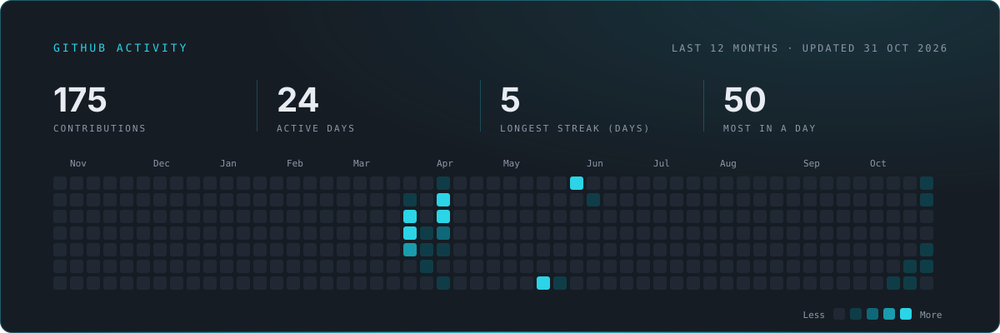

<picture>
  <source media="(prefers-color-scheme: dark)" srcset="assets/banner-dark.png">
  
</picture>

---

## Douklar

Douklar moves AWS data between accounts and Regions: **ECR images, S3 objects, CodeCommit repositories and DynamoDB items**. One workflow covers all four: account profiles, discovery, mappings, a read-only preflight, a reviewed run, verification, and a record of every run.

- **Self-hosted.** A web console and a `douklar` CLI that you run yourself. There is no hosted version.
- **Internal test phase.** Douklar is not in production yet. Its docs are published for internal testers and as an introduction.
- **AWS first.** Other clouds are planned. Need one? [Ask for it](https://douklar.app/request).

---

## Projects

| Project | What it does | Licence |
| --- | --- | --- |
| **[Douklar](https://douklar.app)** | Moves ECR, S3, CodeCommit and DynamoDB data between AWS accounts and Regions. Source not public yet. | AGPL-3.0-or-later, can change before the public release |
| **[SSM Explorer](https://github.com/douklar/ssm-explorer)** | Search, browse, diff and export AWS SSM Parameter Store parameters from your terminal. Read-only. | MIT |
| **[Agent Workspace](https://github.com/douklar/terraform-aws-agent-workspace)** | Terraform module for a personal AI agent workspace on AWS, reached through Session Manager with no open ports.  | Apache-2.0 |
| **[file-safe](https://github.com/douklar/file-safe)** | Scans files and directories against the VirusTotal API, for public downloads in network-isolated Linux environments. | None yet |

Each repository has its own README, licence and contribution guide. Bugs and ideas go in that repository's issues.

---

## Built with

---

## Contact

Questions, licensing and platform requests: **douklar@hummatovic.com**. Douklar is made by [Nijat Hummatović](https://github.com/hummatovic).

